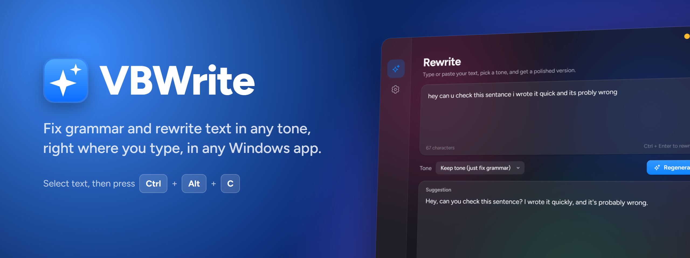
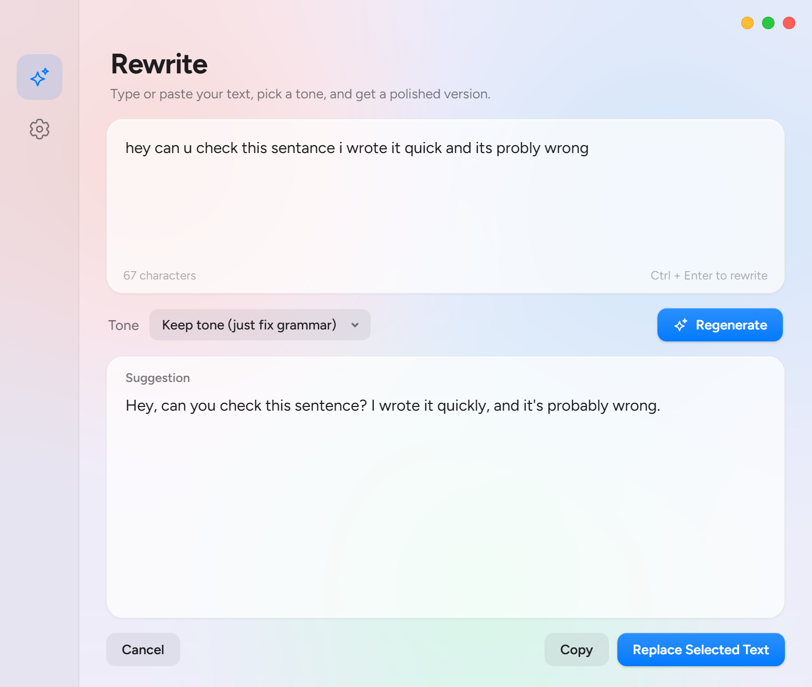
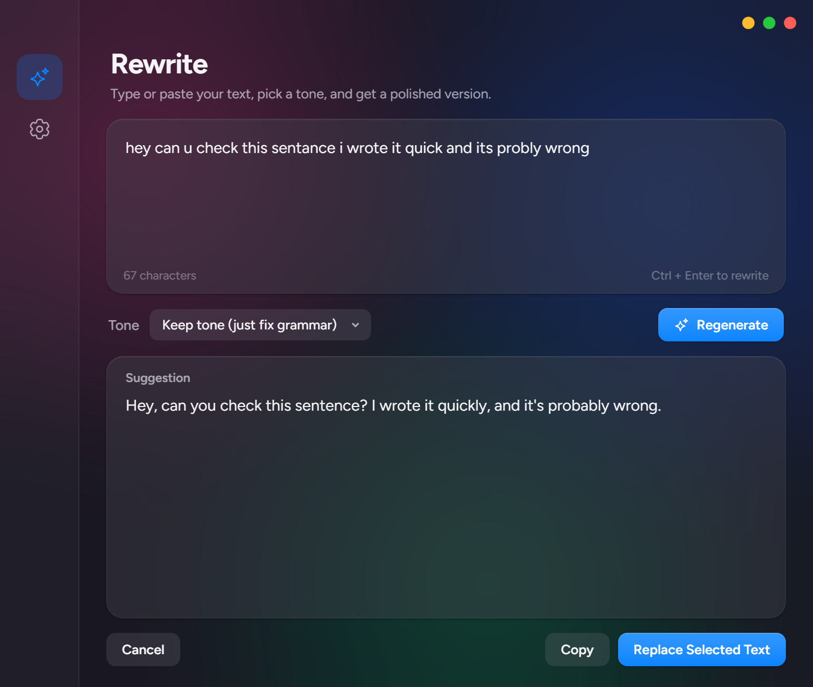
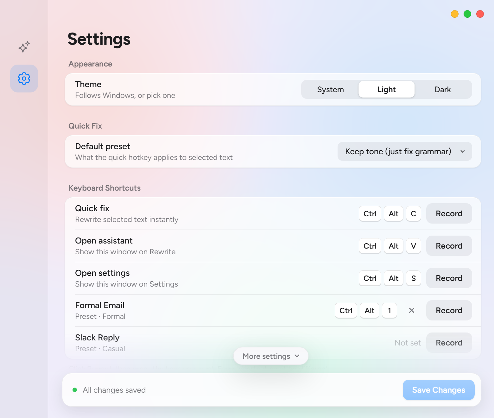
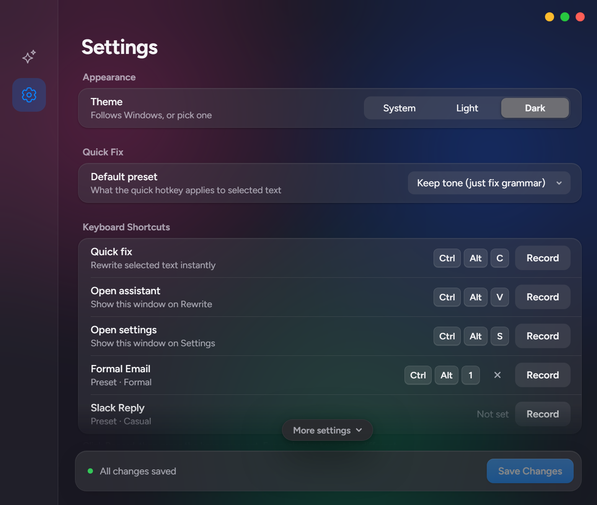

  

  
  
  

  <a href="https://github.com/DevHydeOut/vbwrite/releases/latest/download/VBWrite.exe"><b>⬇ Download VBWrite for Windows</b></a>
  &nbsp;·&nbsp;
  <a href="#-getting-started">Getting started</a>
  &nbsp;·&nbsp;
  <a href="#-report-a-problem">Report a problem</a>

---

**VBWrite** is a small Windows app that lives in your system tray and fixes your writing wherever you type: email, Slack, Word, your browser, anything. Select some text, press a shortcut, and it is corrected or rewritten in the tone you want, right in place.

 

## ✨ Features

- **Fix anything, anywhere.** Select text in any app and press `Ctrl+Alt+C`. It's replaced with the corrected version instantly.
- **Rewrite in any tone.** Formal, casual, friendly, professional, polite, confident or concise.
- **Your own presets.** Save tones you use often, like "Formal Email" or "Slack Reply", and give each its own shortcut.
- **Bring your own AI.** Works with Groq and Gemini (both free), OpenAI (ChatGPT), Anthropic (Claude), or any OpenAI-compatible service, including local models through Ollama or LM Studio.
- **Automatic fallback.** If your main provider fails, VBWrite tries the backup automatically.
- **Light and dark mode** with a native Windows 11 frosted-glass look.
- **Updates itself.** You get a notification when a new version is out, and one click installs it.

## 📸 Screenshots

| Light | Dark |
| --- | --- |
|  |  |
|  |  |

## 🚀 Getting started

1. **[Download VBWrite.exe](https://github.com/DevHydeOut/vbwrite/releases/latest/download/VBWrite.exe)** and put it in its own folder, for example `Documents\VBWrite`. Your settings are saved next to it.
2. **Run it.** The first time, Settings opens automatically.
3. **Add an API key** under **API Keys**, press **Test**, then **Save Changes**. A free key from either of these is enough:
   - Groq: [console.groq.com/keys](https://console.groq.com/keys)
   - Gemini: [aistudio.google.com/apikey](https://aistudio.google.com/apikey)
4. **Select some text anywhere and press `Ctrl+Alt+C`.**

> [!NOTE]
> A ChatGPT Plus or Claude Pro subscription doesn't include API access. To use OpenAI or Claude, create an API key at [platform.openai.com](https://platform.openai.com/api-keys) or [console.anthropic.com](https://console.anthropic.com/settings/keys). It's billed separately, usually a fraction of a cent per rewrite.

> [!TIP]
> To start VBWrite automatically, press `Win+R`, type `shell:startup`, and put a shortcut to `VBWrite.exe` in the folder that opens.

## ⌨️ Shortcuts

| Shortcut | What it does |
| --- | --- |
| `Ctrl+Alt+C` | Fix the selected text instantly, using your default preset |
| `Ctrl+Alt+V` | Open the Rewrite window with the selected text, to pick a tone first |
| `Ctrl+Alt+S` | Open Settings |

You can change all of these, and give each preset its own shortcut, in **Settings → Keyboard Shortcuts**.

## 🔒 Privacy

- Your API keys are stored only on your PC, in `config.json` next to the app.
- The text you rewrite is sent only to the AI provider you choose, and nowhere else.
- VBWrite has no account, no tracking and no analytics. It contacts GitHub only to check for updates.

## 🐞 Report a problem

Something not working? Please **[open an issue](https://github.com/DevHydeOut/vbwrite/issues/new/choose)** and include:

- Your VBWrite version (**Settings → About**) and Windows version
- What you did, what you expected, and what happened instead
- The exact error message, or a screenshot of it

> [!CAUTION]
> Never paste your API keys or your `config.json` into an issue. Issues are public.

### Common fixes

| Problem | Fix |
| --- | --- |
| **"Windows protected your PC"** on first run | Click **More info**, then **Run anyway**. This appears because the app isn't code-signed yet. |
| **The app doesn't open** | Install the [Microsoft Edge WebView2 Runtime](https://developer.microsoft.com/microsoft-edge/webview2/). It's already on Windows 11 and most up-to-date Windows 10 PCs. |
| **"Add your … API key"** | Open **Settings → API Keys**, paste a key, press **Test**, then **Save Changes**. |
| **"API error 401" or "403"** | The key is wrong or has been revoked. Create a new one and paste it again. |
| **"API error 429"** | You've hit the provider's rate limit or free quota. Wait a minute, or set a **Fallback** provider. |
| **The shortcut does nothing in one app** | If that app runs as Administrator, VBWrite must too. Windows blocks shortcuts between them otherwise. |
| **Text isn't replaced** | Make sure the text is still selected and the field is editable. You can also use `Ctrl+Alt+V` and copy the result. |

## 💬 Feedback

Ideas and feature requests are welcome. [Open an issue](https://github.com/DevHydeOut/vbwrite/issues/new/choose) and pick **Feature request**.

---

Made by <b>Vimal Bhatt</b>

